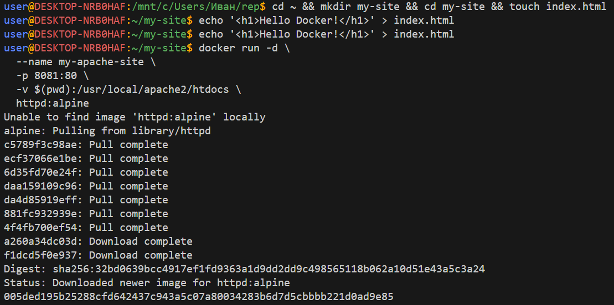
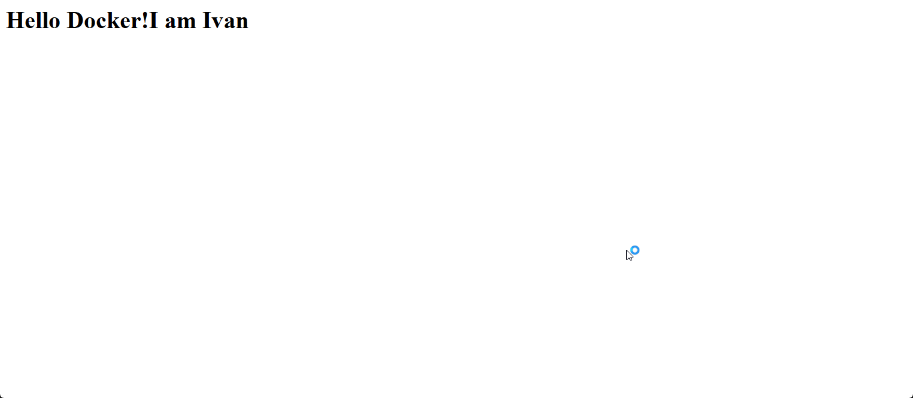

## Apache со статический сайтом вне контейнера (сайт на хосте)

- > ## Для выполнения этого задания используйте WSL или любой другой Linux или Mac!

Выполните все этапы работы с проектом по примеру с [Nginx](/content/Docker/ImageLibrary/Nginx.md)

- > Никогда в разработке не используйте русские имена файлов и каталогов!
- > Никогда в разработке не используйте пробелы и спец.символы в именах файлов и каталогов!
- > Перед созданием проекта убедитесь, что порт, который собираетесь использовать не занят другим приложением!
- > Создание проекта лучше начать с "чистого листа", предварительно остановив и удалив все другие контейнеры и образы!

### 1. Подготовка

Перед выполнением этого задания рекомендуется завершить и удалить все имеющиеся учебные контейнеры:

Остановить все запущенные контейнеры:
```shell
docker stop $(docker ps -q)
```
Удалить все остановленные или не запущенные (Exited, Created) учебные контейнеры:
```shell
docker container prune
```
> **Prune** — удаляйте ненужные контейнеры, чтобы не засорять ваш Docker!

Или так удалить все учебные контейнеры (включая запущенные — принудительно):
```shell
docker rm -f $(docker ps -aq)
```
Очистить все ненужные (учебные) тома:
```shell
docker volume prune -a
```
Опционально: можно удалить образы и кеш сборок в Docker

Удаление всех образов
```shell
docker image prune -a
```
Очистить кэш всех сборок:
```shell
docker builder prune -a
```

- [Подробней про управление Docker в шпаргалке](/content/Docker/DockerReminder.md)

***

### 2. Создание каталога проекта

Создайте папку с HTML-файлом:
```shell
cd ~ && mkdir my-site && cd my-site && touch index.html
```
Выполните эту команду для вставки в index.html короткого кода:
```shell
echo '<h1>Hello Docker!</h1>' > index.html
```
Чтобы в веб-странице поддерживался русский язык, вставьте тэг `<meta charset="UTF-8">` выше основного кода

### 3. Запустите **Apache** с монтированием папки (для Windows)

Настройки Docker Desktop в Windows
- Откройте `Docker Desktop → Settings → Resources → File Sharing`;
- Убедитесь, что диск `C:\` есть в списке. Если нет – добавьте его;
- Перезапустить компьютер.

> ### Для Linux никаких дополнительных настрок не нужно!

### 4.  Запустите **Apache** с монтированием папки

> Перед созданием проекта убедитесь, что порт `8081` не занят другим приложением!

<u>Находясь в папке проекта</u> `my-site`, выполните загрузку образа, создание контейнера с сервером и его запуск:

**Git-Bash/Linux/WSL 2.0/Mac**
```shell
docker run -d \
  --name my-apache-site \
  -p 8081:80 \
  -v $(pwd):/usr/local/apache2/htdocs \
  httpd:alpine
```



[Откройте: http://localhost:8081](http://localhost:8081)



Для изменения содержимого `index.html` выполните его редайтирование в **VS Code** из папки `my-site` на вашем компьютере (не внутри контейнера!). С помощью нейросети создайте красивую страницу статического сайта.

Если по этому адресу будет откраться другая страница, то просто обновите страницу в браузере!

**Результат оформить в виде отдельного `README.md` со скриншотами результатов ваших действий и прислать ссылку преподавателю.**

> Если вы обнаружили ошибку в этом тексте - сообщите пожалуйста автору!